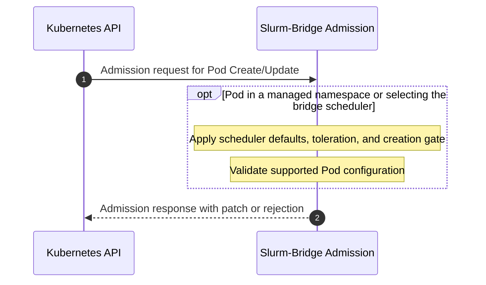

# Admission

## Table of Contents

<!-- mdformat-toc start --slug=github --no-anchors --maxlevel=6 --minlevel=1 -->

- [Admission](#admission)
  - [Table of Contents](#table-of-contents)
  - [Overview](#overview)
  - [Design](#design)
    - [Sequence Diagram](#sequence-diagram)
  - [Workload annotation deprecation](#workload-annotation-deprecation)
  - [Unsupported scheduling requests](#unsupported-scheduling-requests)

<!-- mdformat-toc end -->

## Overview

[The Kubernetes documentation](https://kubernetes.io/docs/reference/access-authn-authz/admission-controllers/)
defines admission controllers as:

> a piece of code that intercepts requests to the Kubernetes API server prior to
> persistence of the resource, but after the request is authenticated and
> authorized.

It also states that:

> Admission control mechanisms may be validating, mutating, or both. Mutating
> controllers may modify the data for the resource being modified; validating
> controllers may not.

The `slurm-bridge` admission controller is both mutating and validating. It
modifies pods within namespaces specified in `helm/slurm-bridge/values.yaml` to
use the `slurm-bridge` [scheduler] instead of the default Kubernetes scheduler,
and rejects unsupported scheduling and resource configurations.

## Design

Pods created in the specified namespaces with the default Kubernetes scheduler
have `.spec.schedulerName` changed to the slurm-bridge [scheduler]. Explicitly
selected custom schedulers are preserved. Pods selecting the bridge scheduler,
including those outside managed namespaces, receive its managed-node toleration
and a registration scheduling gate. New Pods remain `SchedulingGated` until the
controller registers their Slurm allocation. The Helm webhooks exclude
`kube-system` and the bridge's installation namespace.

Managed namespaces are defined as a list of namespaces as configured in the
admission controller's `values.yaml` for `managedNamespaces[]`. Alternatively, a
`managedNamespaceSelector` can be used to select namespaces based on labels. If
`managedNamespaceSelector` is set, `managedNamespaces` will be ignored.

Pods selected for the slurm-bridge [scheduler] receive the
`slinky.slurm.net/managed-node` toleration during admission. If admission is
disabled or the pod's namespace is excluded from the webhook, set this
toleration explicitly to run on bridged nodes. The scheduler treats the pods it
receives as immutable and does not add tolerations.

Managed pods can request either native `cpu` or the CPU DRA extended resource
`deviceclass.resource.kubernetes.io/dra.cpu`, but cannot specify both. CPU DRA
must be requested explicitly; native `cpu` requests are not converted to DRA
requests by the admission controller.

CPU DRA requires `slurmjob.slinky.slurm.net/exclusive: "false"` on the
workload's [annotation source](workload.md#pod-grouping). Standalone pods that
omit it or enable exclusive allocation are rejected at admission. For
controller-owned and grouped pods, the scheduler checks the resolved annotations
before releasing the held Slurm job for allocation. Native CPU and GPU-only
requests still support exclusive allocation.

In-place resizing is not supported for managed pods. The admission controller
rejects requests to the `pods/resize` subresource so Kubernetes resources cannot
diverge from the corresponding Slurm allocation.

Pod topology spread constraints are not supported. The admission controller
rejects managed pods with a non-empty `spec.topologySpreadConstraints` field.
Required node affinity, Pod affinity, and Pod anti-affinity are also rejected at
creation; use a Slurm partition or constraint for placement. Pods cannot provide
`spec.resourceClaims`; request DRA devices through DeviceClass extended
resources instead.

The `slurmjob.slinky.slurm.net/constraints` annotation is combined with the
`slurm_bridge_gres_compatible` node feature that every bridge job requires. The
admission controller rejects Pod annotations containing constraint expressions
that Slurm's grammar does not allow to be combined with an additional feature,
such as a bare feature count (`rack1*2`) or an OR outside parentheses mixed with
parentheses or brackets (`(a&b)|(c&d)`), so the job fails at creation rather
than on every scheduling cycle. Annotations on owning workloads and PodGroups
are resolved later and checked before Slurm submission, not by the Pod admission
webhook. See [supported Slurm job annotations] for the supported forms.

Managed pods are also validated against the supported DRA DeviceClass set.
Unsupported DeviceClass resources in requests or limits are rejected for init
containers and regular containers. Operators can extend the supported set with
configured device profiles. See [Device resources] for the built-in classes,
profile configuration, and legacy device-plugin resources. Pods outside managed
namespaces that do not select the `slurm-bridge` scheduler are not subject to
this validation.

### Sequence Diagram

## Workload annotation deprecation

By default, a ValidatingAdmissionPolicy warns about top-level
`slurmjob.slinky.slurm.net/*` annotations on Jobs, JobSets, LeaderWorkerSets,
PodGroups, CompositePodGroups, and Workloads when they are created. Requests
remain allowed. Move annotations to Pod templates;
[Pod annotations take precedence](workload.md#resolution-rules) during the
transition. To reject these annotations instead, install or upgrade with
`--set admission.workloadAnnotationAction=Deny`. Set it to `Warn` (the default)
to allow requests with a warning. The policy only checks CREATE requests in both
modes; updates to existing workloads remain allowed.

The planned transition is warnings, then denial by default, then removal of
legacy annotation support. Release timing will depend on deprecation feedback.

The policy uses `admission.managedNamespaces` or
`admission.managedNamespaceSelector`, excluding `kube-system` and the bridge
installation namespace. Pod and Pod template annotations are allowed in both
modes. Disabling admission or clearing both namespace settings omits the policy.

## Unsupported scheduling requests

Pods routed to the bridge are rejected with field-specific Kubernetes errors
when they request unsupported scheduling behavior. The registration controller
checks every allocation member before creating a held Slurm job or publishing
registration metadata and removing its gate. The scheduler repeats these checks
before updating or releasing an allocation, including when admission is
disabled. Duplicate-allocation cleanup remains available for rejected workloads.
Direct node targeting is rejected at admission because it bypasses scheduling
entirely. Unchanged violations on already-bound pods do not block metadata or
status updates after an upgrade. Pods using another scheduler are outside this
policy.

- Preferred node affinity is rejected because Slurm controls node scoring.

- Inter-pod affinity is rejected for both required and preferred terms.

- Inter-pod anti-affinity is rejected for both required and preferred terms.

- Required node affinity remains blocked until the hard-node-placement support
  phase. This check also covers empty required selectors and every shared
  allocation member.

- Explicit topology spreading is rejected for both `DoNotSchedule` and
  `ScheduleAnyway`.

- Creating a pod with `spec.nodeName` is rejected rather than silently clearing
  the requested node. Normal scheduler binding and bound-pod updates remain
  allowed.

- `csi` volumes are rejected: inline CSI ephemeral volumes need a validated
  driver lifecycle and node availability contract; use supported kubelet volume
  sources.

- `ephemeral` volumes are rejected: generic ephemeral volumes need validated PVC
  provisioning, ownership and cleanup; use supported kubelet volume sources.

- `hostPath` volumes are rejected: hostPath needs an explicit node-local data
  placement contract; use supported shared storage.

- All other volume sources are rejected by an explicit allowlist. Kubelet
  volumes (`emptyDir`, ConfigMap, Secret, projected, downwardAPI, image), inline
  NFS, and PVCs remain allowed. PVCs use the scheduler's existing VolumeBinding
  checks. This does not guarantee node disk capacity, image feature
  availability, or NFS reachability.

- Shared allocation members must use the same hard node policy within each Slurm
  component. The comparison does not span heterogeneous components. Nonempty
  node policies are rejected.

- Nonempty `nodeSelector` requests are rejected.

<!-- Links -->

[device resources]: workload.md#device-resources
[scheduler]: scheduler.md
[supported slurm job annotations]: workload.md#supported-slurm-job-annotations
