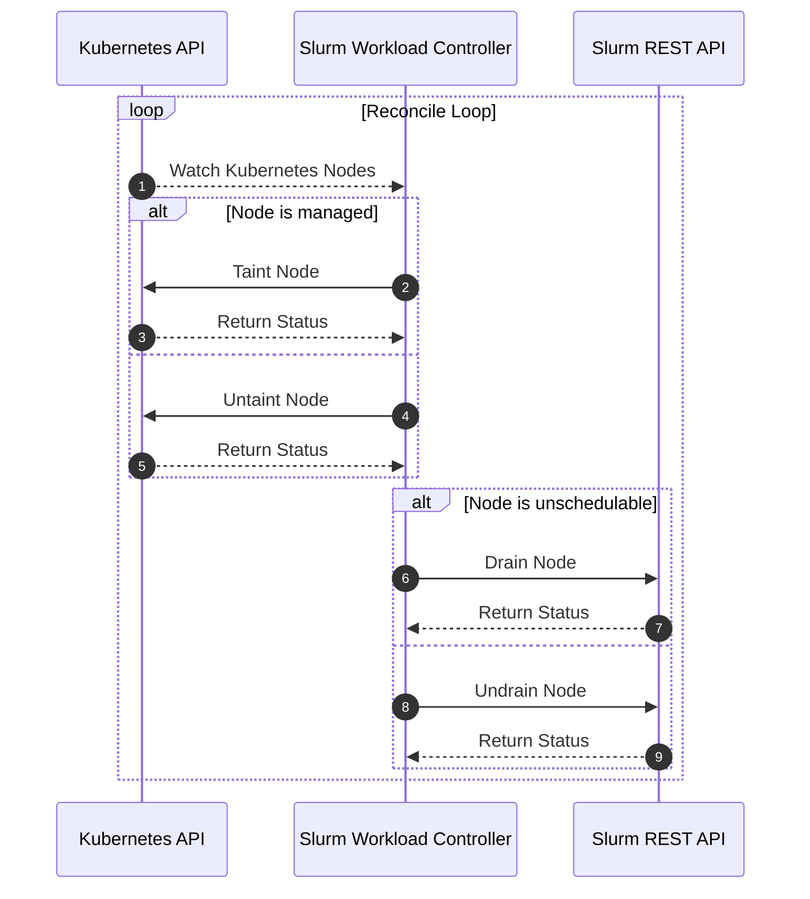

# Controllers

## Table of Contents

<!-- mdformat-toc start --slug=github --no-anchors --maxlevel=6 --minlevel=1 -->

- [Controllers](#controllers)
  - [Table of Contents](#table-of-contents)
  - [Overview](#overview)
  - [Node Controller](#node-controller)
    - [Node Registration and Partition Assignment](#node-registration-and-partition-assignment)
  - [Registration Controller](#registration-controller)

<!-- mdformat-toc end -->

## Overview

[The Kubernetes documentation](https://kubernetes.io/docs/concepts/architecture/controller/)
defines controllers as:

> control loops that watch the state of your cluster, then make or request
> changes where needed. Each controller tries to move the current cluster state
> closer to the desired state.

Within `slurm-bridge`, there are multiple controllers that manage the state of
different bridge components:

- **Node Controller** - Responsible for tainting the Kubernetes nodes that are
  managed by `slurm-bridge`
- **Registration Controller** - Prepares held Slurm allocations and publishes
  registration metadata to their Pods
- **Workload Controller** - Responsible for synchronizing Slurm and Kubernetes
  workloads on the nodes that are managed by `slurm-bridge`

## Node Controller

The node controller is responsible for tainting the managed nodes so the
scheduler component is fully in control of all workload that is bound to those
nodes.

Additionally, this controller will reconcile certain node states for scheduling
purposes. Slurm becomes the source of truth for scheduling among managed nodes.

A managed node is a Kubernetes node with a corresponding Slurm node. This
includes both [external and hybrid nodes](config.md#nodes); only hybrid nodes
require a colocated `slurmd`.

### Node Registration and Partition Assignment

The node controller supports dynamic node registration in Slurm through
Kubernetes node labels:

- **Node Registration Label** (`scheduler.slinky.slurm.net/external-node`): When
  this label is present on a Kubernetes node, the node controller will
  automatically register the node in Slurm with the correct CPU and memory
  resources. When the label is removed, the node will be removed from Slurm.

- **Node Partitions Annotation**
  (`scheduler.slinky.slurm.net/external-node-partitions`): Specifies the Slurm
  partition(s) the node should be assigned to. The value is a comma-separated
  list of partition names. When this annotation is set, the node controller
  will:

  1. Validate that all specified partitions exist in Slurm
  1. Register the node with node features matching the partition names
  1. Allow Slurm's NodeSet configuration in `slurm.conf` to assign the node to
     those partitions

  **Example:**

  ```yaml
  apiVersion: v1
  kind: Node
  metadata:
    name: worker-1
    labels:
      scheduler.slinky.slurm.net/external-node: "true"
    annotations:
      scheduler.slinky.slurm.net/external-node-partitions: "slurm-bridge,gpu"
  ```

  This will register the node with features `slurm-bridge,gpu`, allowing it to
  be assigned to those partitions in `slurm.conf` using NodeSet features.

  **Note:** The controller will error if any specified partition does not exist
  in Slurm. Partitions must be pre-configured in Slurm's configuration.



## Registration Controller

The registration controller owns allocation registration, metadata repair,
cleanup, and Pod finalization on one queue keyed by allocation identity. It
creates held Slurm allocations and removes registration gates once allocation
metadata is published.

Cleanup uses current Kubernetes group membership, including late members, as
well as the Pod identities recorded in Slurm. Before cancellation it confirms
membership through the Kubernetes API and ownership through Slurm. A deleting,
bound Pod retains its allocation until it becomes terminal. Running
heterogeneous jobs can release individual nonzero components. Component zero and
pending heterogeneous jobs are retained while any member needs the allocation.

Bound Pods whose jobs stop running are deleted after a live Slurm check. Claims
and scheduler finalizers are removed only after Slurm reports the allocation
finished or absent; a cancellation acknowledgement alone does not release them.
The Slurm informer reconstructs cleanup work after restarts. The separate Pod
controller and dangling-job sweep are no longer used.

Configure concurrency with `controllers.registrationWorkers` in Helm or
`--registration-workers` on the controllers binary. The default is 10 workers.
The Node controller also defaults to 10 workers, configurable with
`--node-workers`. `controllers.podWorkers` and `--pod-workers` remain accepted
for compatibility but have no effect. Cache reads retain the existing Slurm
client refresh waits. This ownership change does not alter allocation formation
for late composite components.
