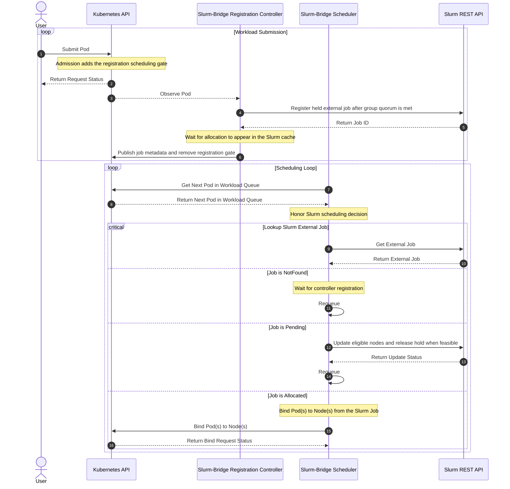

# Scheduler

## Table of Contents

<!-- mdformat-toc start --slug=github --no-anchors --maxlevel=6 --minlevel=1 -->

- [Scheduler](#scheduler)
  - [Table of Contents](#table-of-contents)
  - [Overview](#overview)
  - [Design](#design)
    - [Native gang state](#native-gang-state)
    - [Sequence Diagram](#sequence-diagram)
    - [External Jobs](#external-jobs)
      - [Annotations](#annotations)

<!-- mdformat-toc end -->

## Overview

In Kubernetes, scheduling refers to making sure that pods are matched to nodes
so that the kubelet can run them.

The scheduler controller in `slurm-bridge` is responsible for [scheduling]
eligible pods onto nodes that are managed by `slurm-bridge`. In doing so, the
`slurm-bridge` scheduler interacts with the Slurm REST API in order to acquire
allocations for its workloads. In `slurm-bridge`, `slurmctld` serves as the
source of truth for scheduling decisions.

## Design

This scheduler is designed to be a non-primary scheduler (e.g. should not
replace the default [kube-scheduler]). This means that only certain pods should
be scheduled via this scheduler (e.g. non-critical pods).

This scheduler represents Kubernetes Pods as a Slurm Job, waits for Slurm to
schedule the Job, then informs Kubernetes on which nodes to allocate the
represented Pods. This scheduler defers scheduling decisions to Slurm, hence
certain assumptions about the environment must be met for this to function
correctly.

The scheduler refreshes Slurm job information every second and node information
every 30 seconds. Scheduling may wait for an in-progress refresh for up to two
seconds for jobs or 60 seconds for nodes. Failed refreshes defer scheduling.

### Native gang state

Within a native PodGroup scheduling attempt, members share one workload
translation, membership snapshot, and allocation observation from the allocation
observer's job cache. CompositePodGroup components share the same decision up to
their allocation boundary; independent allocations below basic groups remain
separate. Both native `v1alpha2` and `v1beta1` APIs use this path.

Node assignments are prepared once per component, preserving bound nodes and
existing assignments. Remaining Pods and nodes are matched in name order.
Duplicate assignments and insufficient capacity reject the attempt. Assignment
patches use resource-version guards; a partial write is retried from a fresh
snapshot. Filter reads the decision from cycle state without modifying shared
framework or informer Pods. Eligibility updates use private copies of the shared
translation, and all components must pass eligibility before hold release.

Each new scheduling attempt rebuilds its snapshots, including after membership,
identity, allocation, or feasibility changes. A changed member encountered
within an attempt is rejected rather than added to an existing allocation
decision. Snapshots are not cached across retries. This does not change the
registration policy for composite children that arrive after allocation
submission.

Member state retains the decision when the framework detaches group state for
concurrent binding. Each Pod still validates allocation identity and its
selected node against Slurm before creating claims. A component's resource
layout is read once and shared across binding members; node metadata reads run
concurrently, with at most eight such requests across the process. A failed
resource read fails that attempt and can be retried in a new attempt. These
checks do not make Slurm validation and Kubernetes binding atomic.

Legacy `scheduling.x-k8s.io/v1alpha1` groups retain their existing scheduling
path and deprecation policy.

### Sequence Diagram



### External Jobs

Slurm-bridge uses Slurm to schedule both Slurm and Kubernetes workloads on the
same resources. To do this, slurm-bridge must represent Kubernetes workloads as
a Slurm job that is submitted for the purpose of scheduling. This job is
referred to as an "external job", as it is only used for scheduling: once an
external job is allocated resources, the actual execution of the workload is
handled by the Kubelet.

#### Annotations

Slurm-bridge accepts the following workload types: Jobs, JobSets, Pods,
PodGroups, and LeaderWorkerSets. Annotations can be set on the workload object
to change the parameters that are used to submit an external job to Slurm. The
following table lists some of the available annotations. For a complete list,
see
[Supported Slurm job annotations](workload.md#supported-slurm-job-annotations).

| Annotation                             | Description                       | Example      |
| -------------------------------------- | --------------------------------- | ------------ |
| slurmjob.slinky.slurm.net/account      | Sets the account at submission.   | "schedmd"    |
| slurmjob.slinky.slurm.net/gres         | Overrides the default gres.       | "gres/gpu=2" |
| slurmjob.slinky.slurm.net/job-name     | Sets the job name.                | "research"   |
| slurmjob.slinky.slurm.net/max-nodes    | Sets the maximum number of nodes. | "3"          |
| slurmjob.slinky.slurm.net/mem-per-node | Sets the amount of memory.        | "8Gi"        |
| slurmjob.slinky.slurm.net/partition    | Overrides the default partition.  | "debug"      |
| slurmjob.slinky.slurm.net/priority     | Sets the job priority.            | "100"        |
| slurmjob.slinky.slurm.net/timelimit    | Sets the job time limit.          | "30m"        |

The time limit accepts a duration with a unit suffix (`s`, `m`, `h`, `d`, `w`),
one of Slurm's `--time` formats (`MM:SS`, `HH:MM:SS`, `D-HH`, `D-HH:MM`,
`D-HH:MM:SS`), or a bare integer, which is read as minutes. Slurm's time limit
has minute granularity, so anything shorter than a minute is rounded up to one
minute.

An example of the annotations in use:

```yaml
---
apiVersion: batch/v1
kind: Job
metadata:
  name: job-sleep-single
  namespace: slurm-bridge
  annotations:
    slurmjob.slinky.slurm.net/job-name: job-sleep-single
    slurmjob.slinky.slurm.net/account: schedmd
    slurmjob.slinky.slurm.net/partition: debug
spec:
  completions: 1
  parallelism: 1
  template:
    spec:
      schedulerName: slurm-bridge-scheduler
      containers:
        - name: sleep
          image: busybox:stable
          command: [sh, -c, sleep 3]
          resources:
            requests:
              cpu: '1'
              memory: 100Mi
            limits:
              cpu: '1'
              memory: 100Mi
      restartPolicy: Never
```

<!-- Links -->

[kube-scheduler]: https://kubernetes.io/docs/concepts/architecture/#kube-scheduler
[scheduling]: https://kubernetes.io/docs/concepts/scheduling-eviction/kube-scheduler/#scheduling
