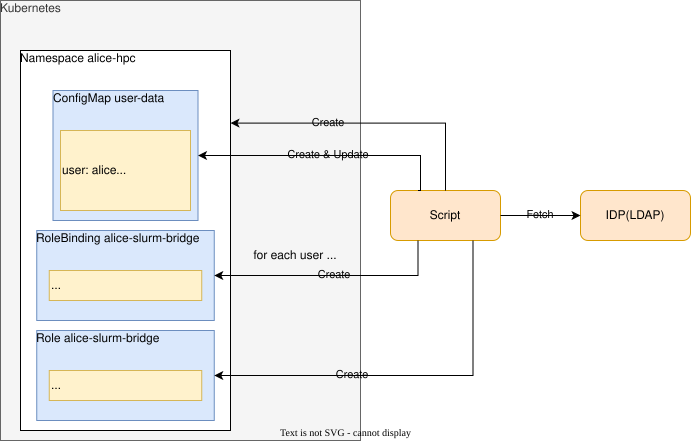
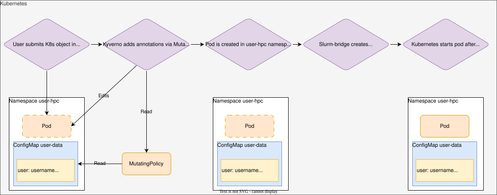

# User Management in Slurm-bridge

## Table of Contents

<!-- mdformat-toc start --slug=github --no-anchors --maxlevel=6 --minlevel=1 -->

- [User Management in Slurm-bridge](#user-management-in-slurm-bridge)
  - [Table of Contents](#table-of-contents)
  - [Overview](#overview)
  - [Using Kyverno Policies with Slurm-bridge](#using-kyverno-policies-with-slurm-bridge)
    - [Overview of Kyverno](#overview-of-kyverno)
    - [Configuring Kyverno for use with Slurm-Bridge](#configuring-kyverno-for-use-with-slurm-bridge)
    - [Example Kyverno Policies for Slurm-bridge](#example-kyverno-policies-for-slurm-bridge)
    - [Automated user isolation with connection to an IDP](#automated-user-isolation-with-connection-to-an-idp)
      - [Requirements](#requirements)
      - [IDP connection script](#idp-connection-script)
      - [Kyverno MutatingPolicy to set `slurmjob.slinky.slurm.net/account` and `slurmjob.slinky.slurm.net/user-id` on the user's behalf](#kyverno-mutatingpolicy-to-set-slurmjobslinkyslurmnetaccount-and-slurmjobslinkyslurmnetuser-id-on-the-users-behalf)
      - [Kyverno ValidatingPolicy to ensure users are submitting to a specific partition](#kyverno-validatingpolicy-to-ensure-users-are-submitting-to-a-specific-partition)

<!-- mdformat-toc end -->

## Overview

Slurm-bridge uses [external jobs](scheduler.md) to represent Kubernetes
workloads in Slurm for scheduling purposes. External jobs are submitted using
the JWT in the existing Secret selected by `sharedConfig.slurmJwtSecret`. The
chart does not generate this token; provision it with `scontrol` or a
slurm-operator `Token`, as shown in the [quickstart](quickstart.md). By default,
jobs use the Slurm identity authenticated by that token (the quickstart uses
`slurm`), but they may be submitted as another user by using the
`slurmjob.slinky.slurm.net/user-id` annotation.

Container users are determined by the Pod's security context and container
image. The Slurm `user-id` annotation does not change the container's runtime
user.

## Using Kyverno Policies with Slurm-bridge

### Overview of Kyverno

[Kyverno] is a cloud-native policy engine, which can be used to enforce security
policies using a Kubernetes admission controller. When running Slurm-bridge in a
multi-tenant production environment, it may be desirable to prevent unprivileged
users from modifying certain fields of Kubernetes objects, in order to prevent
users from using accounts for which they are not authorized.

### Configuring Kyverno for use with Slurm-Bridge

The admission policies below read the `user-data` ConfigMap in the workload's
namespace. Ensure that the Kyverno admission controller can read that ConfigMap.
If its existing roles do not grant access, add the following ClusterRole using
[Kyverno's role aggregation][kyverno-customize-permissions]:

```yaml
apiVersion: rbac.authorization.k8s.io/v1
kind: ClusterRole
metadata:
  name: kyverno:read-slurm-user-data
  labels:
    rbac.kyverno.io/aggregate-to-admission-controller: 'true'
rules:
  - apiGroups:
      - ""
    resources:
      - configmaps
    resourceNames:
      - user-data
    verbs:
      - get
```

After applying this ClusterRole, confirm that the Kyverno admission controller's
top-level ClusterRole has successfully aggregated your new permissions:

```bash
kubectl get clusterrole kyverno:admission-controller -o yaml
```

### Example Kyverno Policies for Slurm-bridge

Below are some example Kyverno policies that can be used with Slurm-bridge.

### Automated user isolation with connection to an IDP

Kyverno policies can be used to automatically configure the annotations on
Slurm-bridge workloads based on data retrieved from an Identity Provider (IDP).
With per-user namespaces, this approach can enforce Slurm user and account
assignments. The examples below cover Pods, Jobs, and built-in PodGroups and
Workloads. Extend the policies to cover the
[annotation sources](workload.md#pod-grouping) used by other workload types
permitted in your deployment.

For built-in PodGroups, annotation precedence is **Workload > PodGroup >
selected Job or JobSet**. Applying the policies to both Workloads and PodGroups
ensures that the higher-precedence values come from the same namespace policy.

The process described here uses a script to configure Kubernetes based on data
from the IDP, and a Kyverno policy to set certain Slinky annotations based on
that data.

#### Requirements

- Usernames in Slurm, Kubernetes, and the IDP should match
- Kyverno must be installed on the Kubernetes cluster
- Enable the [built-in Workload and PodGroup APIs](podgroup.md):
  `scheduling.k8s.io/v1alpha2` on Kubernetes 1.36 or `scheduling.k8s.io/v1beta1`
  on Kubernetes 1.37. The policies match both versions.
- Configure Kyverno to evaluate controller-created resources in the workload
  namespace as well as user requests, including generated Pods and PodGroups.
  Check `excludeGroups` and `excludeUsernames` in the Kyverno ConfigMap for the
  identities used by those controllers.

#### IDP connection script

A script should be used as an intermediary between the IDP and Kubernetes to
synchronize data about users and groups. This script should be run frequently
and automatically using a tool like cron. This script should:

- Fetch users from IDP
- Create a per-user (and/or per-group) namespace based on the users' information
  from the IDP
- Create a ConfigMap in the user's namespace with their Slurm username and
  account information. Users should not be able to modify this ConfigMap.
- Create RoleBindings to grant users permissions within their (or their groups')
  namespace

Below is an example of the ConfigMap created by the script in the user `alice`'s
namespace. The `user` and `account` fields must correspond to a valid Slurm user
and account:

```yaml
apiVersion: v1
kind: ConfigMap
metadata:
  name: user-data
  namespace: alice-hpc
data:
  user: "alice"
  account: "slinky-dev"
  qos: "standard"
  partition: "cpu"
```

This diagram provides a visual reference for the operations of this script:



#### Kyverno MutatingPolicy to set `slurmjob.slinky.slurm.net/account` and `slurmjob.slinky.slurm.net/user-id` on the user's behalf

A Kyverno MutatingPolicy should be created that reads the Slurm user & account
data from the ConfigMap in each user's namespace, and sets the
`slurmjob.slinky.slurm.net/user-id` and `slurmjob.slinky.slurm.net/account`
annotations on workloads submitted in that namespace. Because this policy sets
the Slurm user and account from the administrator-managed ConfigMap on both
`CREATE` and `UPDATE`, users cannot override those assignments for workloads
covered by the policy.

This diagram illustrates how this MutatingPolicy impacts the job submission
flow:



```yaml
apiVersion: policies.kyverno.io/v1
kind: MutatingPolicy
metadata:
  name: slinky-policies
spec:
  evaluation:
    admission:
      enabled: true
  variables:
  - name: slurmConfigmap
    expression: >-
      resource.Get("v1", "configmaps", object.metadata.namespace, "user-data")
  matchConstraints:
    namespaceSelector:
      matchLabels:
        kubernetes.io/metadata.name: alice-hpc
    resourceRules:
      - apiGroups:
        - ''
        apiVersions:
        - 'v1'
        resources:
        - pods
        operations:
        - CREATE
        - UPDATE
      - apiGroups:
        - batch
        apiVersions:
        - 'v1'
        resources:
        - jobs
        operations:
        - CREATE
        - UPDATE
      - apiGroups:
        - scheduling.k8s.io
        apiVersions:
        - v1alpha2
        - v1beta1
        resources:
        - podgroups
        - workloads
        operations:
        - CREATE
        - UPDATE
  mutations:
    - patchType: ApplyConfiguration
      applyConfiguration:
        expression: >
          Object{
            metadata: Object.metadata{
              annotations: {
                'slurmjob.slinky.slurm.net/user-id': string(variables.slurmConfigmap.data.user),
                'slurmjob.slinky.slurm.net/account': string(variables.slurmConfigmap.data.account),
                'slurmjob.slinky.slurm.net/qos': string(has(object.metadata.annotations) && 'slurmjob.slinky.slurm.net/qos' in object.metadata.annotations ? object.metadata.annotations['slurmjob.slinky.slurm.net/qos'] : variables.slurmConfigmap.data.qos),
                'slurmjob.slinky.slurm.net/partition': string(has(object.metadata.annotations) && 'slurmjob.slinky.slurm.net/partition' in object.metadata.annotations ? object.metadata.annotations['slurmjob.slinky.slurm.net/partition'] : variables.slurmConfigmap.data.partition),
                'slurmjob.slinky.slurm.net/job-name': string(has(object.metadata.name) && object.metadata.name != '' ? object.metadata.name : object.metadata.generateName)
              }
            }
          }
```

When this policy is active, the `user-id` and `account` annotations used by
Slurm-bridge will be automatically populated based on the data from the user's
ConfigMap. This policy also overwrites `slurmjob.slinky.slurm.net/job-name` with
the object's name, or its `generateName` prefix when no name has been assigned
yet, even when the user supplied a job name.

Missing `qos` and `partition` annotations are populated from the ConfigMap,
including on controller-created PodGroups. Supplied values are preserved so the
validation policies below can reject values that the namespace does not permit.
Install the mutation and validation policies together.

Below is a snippet of a job that has had these annotations set by the policy:

```console
Name:             job-sleep-single
Namespace:        alice-hpc
...
Annotations:      slurmjob.slinky.slurm.net/account: slinky-dev
                  slurmjob.slinky.slurm.net/job-name: job-sleep-single
                  slurmjob.slinky.slurm.net/user-id: alice
```

#### Kyverno ValidatingPolicy to ensure users are submitting to a specific partition

In some cases it may be necessary to ensure that users are only running
workloads within a specific qos or partition. Kyverno policies can also be used
for this purpose. These policies assume that the IDP connection script provides
a string with a qos or partition within the user's ConfigMap. They validate
top-level annotations on the same Pods, Jobs, built-in PodGroups, and Workloads
matched by the mutation policy, on both creation and update.

```yaml
apiVersion: policies.kyverno.io/v1
kind: ValidatingPolicy
metadata:
  name: enforce-qos-limits
spec:
  evaluation:
    admission:
      enabled: true
    background:
      enabled: false
  variables:
  - name: slurmConfigmap
    expression: >-
      resource.Get("v1", "configmaps", object.metadata.namespace, "user-data")
  validationActions:
    - Deny
  matchConstraints:
    namespaceSelector:
      matchLabels:
        kubernetes.io/metadata.name: alice-hpc
    resourceRules:
      - apiGroups:
        - ''
        apiVersions:
        - v1
        operations:
        - CREATE
        - UPDATE
        resources:
        - pods
      - apiGroups:
        - batch
        apiVersions:
        - v1
        operations:
        - CREATE
        - UPDATE
        resources:
        - jobs
      - apiGroups:
        - scheduling.k8s.io
        apiVersions:
        - v1alpha2
        - v1beta1
        operations:
        - CREATE
        - UPDATE
        resources:
        - podgroups
        - workloads
  validations:
    - message: provided qos is not a permitted qos for user
      expression: >-
        has(object.metadata.annotations) && 'slurmjob.slinky.slurm.net/qos' in object.metadata.annotations && object.metadata.annotations['slurmjob.slinky.slurm.net/qos'] == variables.slurmConfigmap.data.qos

---
apiVersion: policies.kyverno.io/v1
kind: ValidatingPolicy
metadata:
  name: enforce-part-limits
spec:
  evaluation:
    admission:
      enabled: true
    background:
      enabled: false
  variables:
  - name: slurmConfigmap
    expression: >-
      resource.Get("v1", "configmaps", object.metadata.namespace, "user-data")
  validationActions:
    - Deny
  matchConstraints:
    namespaceSelector:
      matchLabels:
        kubernetes.io/metadata.name: alice-hpc
    resourceRules:
      - apiGroups:
        - ''
        apiVersions:
        - 'v1'
        operations:
        - CREATE
        - UPDATE
        resources:
        - pods
      - apiGroups:
        - batch
        apiVersions:
        - v1
        operations:
        - CREATE
        - UPDATE
        resources:
        - jobs
      - apiGroups:
        - scheduling.k8s.io
        apiVersions:
        - v1alpha2
        - v1beta1
        operations:
        - CREATE
        - UPDATE
        resources:
        - podgroups
        - workloads
  validations:
    - message: provided partition is not a permitted partition for user
      expression: >-
        has(object.metadata.annotations) && 'slurmjob.slinky.slurm.net/partition' in object.metadata.annotations && object.metadata.annotations['slurmjob.slinky.slurm.net/partition'] == variables.slurmConfigmap.data.partition
```

Users who attempt to submit or update a covered workload with a qos or partition
that does not match the data in their `user-data` ConfigMap will be unable to do
so, and will see the following message:

```bash
❯ kubectl apply -f hack/examples/pod/sleep.yaml
Error from server: error when creating "hack/examples/pod/sleep.yaml":
admission webhook "vpol.validate.kyverno.svc-fail" denied the request:
Policy enforce-part-limits failed: provided partition is not a permitted partition for user;
Policy enforce-qos-limits failed: provided qos is not a permitted qos for user
```

<!-- Links -->

[kyverno]: https://kyverno.io/
[kyverno-customize-permissions]: https://kyverno.io/docs/installation/customization/#customizing-permissions
